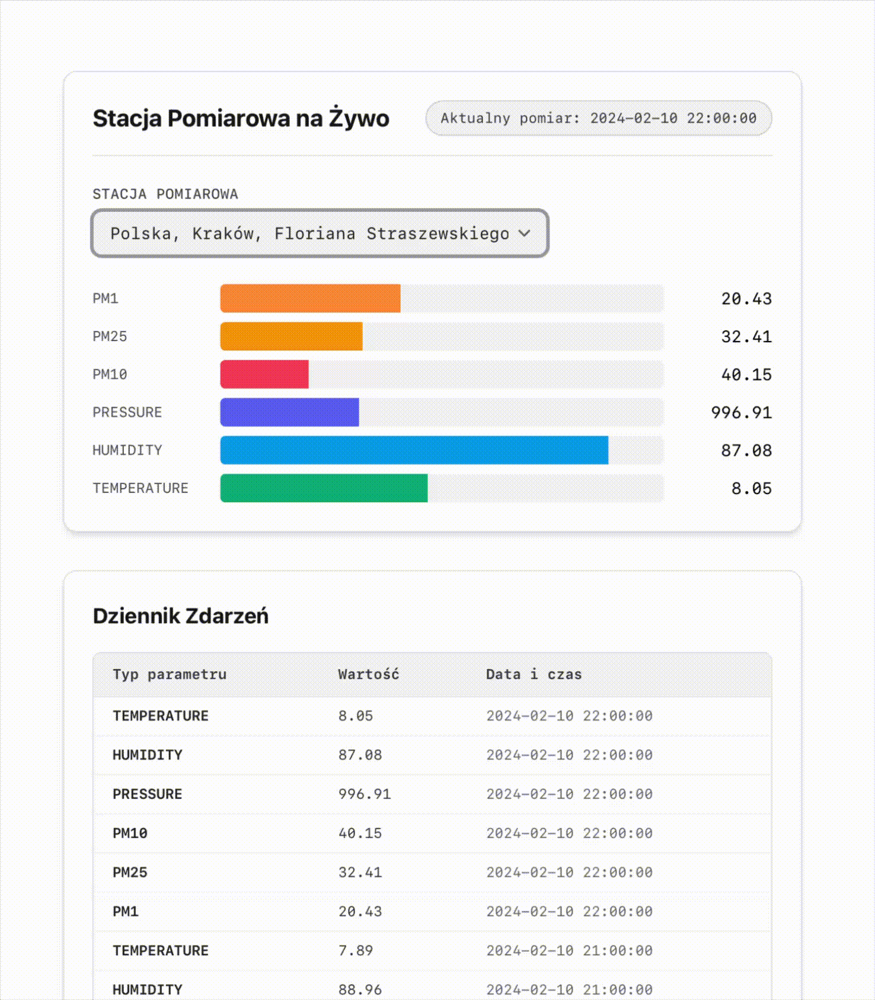

# Pollution App

To start your Phoenix server:

  * Run `mix setup` to install and setup dependencies
  * Start Phoenix endpoint with `mix phx.server` or inside IEx with `iex -S mix phx.server`

Now you can visit [`localhost:4000`](http://localhost:4000) from your browser.


# Real-Time Environmental Telemetry Platform

> Reaktywna aplikacja webowa w **Elixir & Phoenix LiveView** do strumieniowania i wizualizacji danych ze stacji pomiarowych w czasie rzeczywistym.

---

## Demo



---

## Stos technologiczny

* **Język:** Elixir 1.20+
* **Framework:** Phoenix Framework & Phoenix LiveView (v0.20+)
* **Architektura asynchroniczna:** OTP `GenServer`, `Phoenix.PubSub`, WebSockets
* **Warstwa danych:** Ecto & SQLite3
* **Interfejs użytkownika:** Phoenix HEEx & Tailwind CSS

---

## 🏛 Architektura systemu

System opiera się na rozproszonym modelu aktorów platformy Erlang/BEAM:

```text
[ SQLite3 Database ]
       │
       ▼ (Ecto Queries: cursor sorting & limit)
[ Pollutiondb.Streamer (GenServer) ]
       │
       ▼ (Phoenix.PubSub broadcast: "readings", {:batch, datetime, readings})
[ Phoenix.Channel / WebSocket Connection ]
       │
       ▼ (LiveView DOM Diffing: append-only stream)
[ Client Browser (LiveView Streams & CSS Animations) ]
```

1. **Silnik telemetryczny (`Pollutiondb.Streamer`):**
   * Stanowy proces `GenServer` zarządzający wirtualnym zegarem i kursorem osi czasu w bazie danych.
   * Cykliczna emisja paczek odczytów (`:batch`) przez `Phoenix.PubSub` co 1 sekundę (`Process.send_after/3`).
   * Płynne zapętlanie osi czasu po osiągnięciu końca dostępnych danych historycznych.
2. **Reaktywny widok (`PollutiondbWeb.ReadingLive`):**
   * Asynchroniczny odbiór zdarzeń z PubSub za pomocą `handle_info/2`.
   * Bezstanowy, append-only strumień logów zrealizowany za pomocą `phx-update="stream"`, eliminujący narzut pamięciowy w DOM przeglądarki.
   * Dynamiczny selektor stacji (`handle_event/3`) wywołujący asynchroniczną zmianę parametrów w `Streamerze` oraz czyszczenie interfejsu (`reset: true`).

---

## ⚙️ Uruchomienie lokalne

### Wymagania wstępne
* Zainstalowany **Elixir** oraz **Erlang/OTP**
* Narzędzie `mix`

### Kroki instalacji

1. **Sklonuj repozytorium:**
   ```bash
   git clone https://github.com/juliet2112/pollution-app.git
   cd pollution-app
   ```

2. **Pobierz zależności i zainicjalizuj bazę danych:**
   ```bash
   mix setup
   ```

3. **Uruchom serwer Phoenix:**
   ```bash
   mix phx.server
   ```
   *(lub w konsoli interaktywnej IEx: `iex -S mix phx.server`)*

4. **Otwórz aplikację w przeglądarce:**
   Przejdź pod adres: [`http://localhost:4000`](http://localhost:4000)
